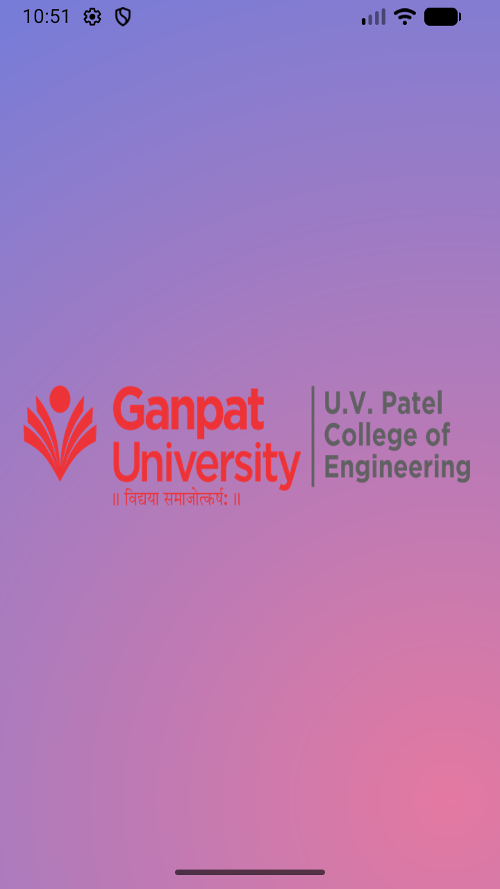

# Frame-by-Frame Animation and Splash Screen with Twin Animation

## AIM

Create an Android application to demonstrate:

1. **Frame-by-Frame Animation**
2. **Twin Animation**
3. **Splash Screen**
4. **Immersive Mode**
5. **Edge-to-Edge Content Display**

### Project Assets

#### Images
Here are the project screenshots:

<div align="center">
  
  
</div>

#### Video Demo
Here is the recorded output video:

[Watch the Output Video](Output_video.webm)

The application demonstrates `AnimationDrawable` for frame-by-frame animation and Android animation resources for twin animation effects.

---

## What is Frame-by-Frame Animation?

Frame-by-frame animation, also called **drawable animation**, displays a sequence of images one after another at a specified interval. Each image represents one frame of the animation.

In Android, frame-by-frame animation can be implemented using:

- `AnimationDrawable`
- `<animation-list>`
- `oneShot` attribute

The images are stored in the `res/drawable` folder and are referenced from an animation-list XML file.

### Example

```xml
<animation-list
    xmlns:android="[http://schemas.android.com/apk/res/android](http://schemas.android.com/apk/res/android)"
    android:oneshot="false">

    <item
        android:drawable="@drawable/frame_1"
        android:duration="100" />

    <item
        android:drawable="@drawable/frame_2"
        android:duration="100" />

    <item
        android:drawable="@drawable/frame_3"
        android:duration="100" />

</animation-list>
